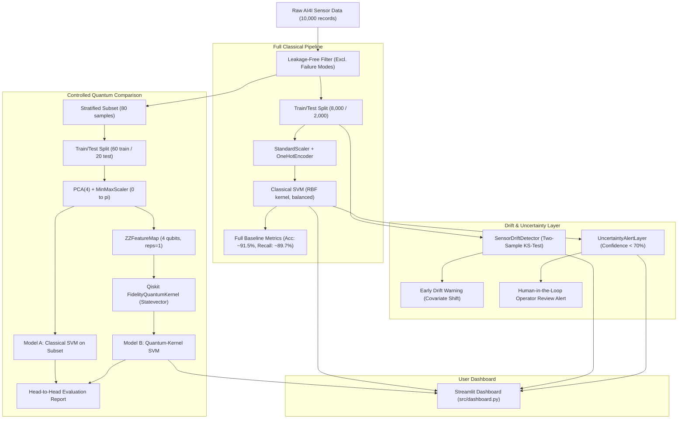

<div align="center">

# Drift-Aware Industrial Fault Detection Using Hybrid Quantum–Classical Machine Learning

**Team:** Phantoms &nbsp;|&nbsp; **Team ID:** VTU-QFF-HC-0005 &nbsp;|&nbsp; **Track:** Quantum + AI/ML

</div>

---

<div align="center">

| | |
| :--- | :--- |
| **Team** | Phantoms |
| **Team ID** | VTU-QFF-HC-0005 |
| **Track** | Quantum + AI/ML |
| **Repository** | [vtu-hc-phantoms](https://github.com/vtu-qiskit-fall-fest-2026/vtu-hc-phantoms.git) |
| **Organisation** | [vtu-qiskit-fall-fest-2026](https://github.com/vtu-qiskit-fall-fest-2026) |
| **Event** | VTU-QFF Hackathon — VTU-Qiskit Fall Fest 2026 |

</div>

---

## 📌 Table of Contents

- [Project Overview & Problem Statement](#-problem-statement)
- [Proposed Solution & Roadmap](#-proposed-solution--roadmap)
- [Interactive Streamlit Dashboard](#-interactive-streamlit-dashboard)
- [Dataset Setup & Leakage Prevention](#-dataset-setup--leakage-prevention)
- [Classical vs. Quantum Methodology](#-classical-vs-quantum-methodology)
- [Sensor Drift Detection (Two-Sample KS Test)](#-sensor-drift-detection-two-sample-ks-test)
- [Uncertainty-Aware Alerting Layer](#-uncertainty-aware-alerting-layer)
- [Approach & Architecture](#-approach--architecture)
- [Tech Stack](#-tech-stack)
- [Project Structure](#-project-structure)
- [How to Run Pipeline & Dashboard](#-how-to-run)
- [Automated Tests](#-automated-tests)
- [Presentation](#-presentation)
- [License](#-license)

---

## ❓ Problem Statement

Industrial fault-detection systems can become unreliable when sensor readings drift over time (due to machine wear, ambient thermal changes, or sensor decalibration) or when labelled fault data is limited. Traditional machine learning models often experience significant performance degradation under distribution shift without alerting human operators.

**Why it matters:** In safety-critical sectors (manufacturing, aerospace, energy), silent failure under distribution shift leads to catastrophic downtime, while uncalibrated alerts overwhelm operators with false alarms.

**Track:** Quantum + AI/ML

---

## 💡 Proposed Solution & Roadmap

We investigate a hybrid quantum–classical machine learning framework that compares a classical Support Vector Machine (SVM) baseline with a simulated quantum-kernel classifier under controlled conditions. The pipeline incorporates early sensor drift warnings, uncertainty-aware alerts to flag potentially unreliable predictions for human review, and an interactive monitoring dashboard.

> [!NOTE]
> **Implementation Status: Phase 5 Completed (Full Application Stack)**
> - [x] **Phase 1: Workspace Scaffolding**: Modular directory structure, repository config, and dependency setup.
> - [x] **Phase 2: Data Loader & Classical Baseline**: Ingestion of UCI AI4I 2020 dataset, leakage-free preprocessing, class-imbalanced RBF-SVM training and evaluation on 10,000 samples.
> - [x] **Phase 3: Quantum-Kernel Classifier & Head-to-Head Benchmark**: Implemented `QuantumKernelClassifier` with Qiskit `zz_feature_map` and `FidelityQuantumKernel` on `Statevector` simulation; constructed a controlled, reproducible stratified comparison benchmark.
> - [x] **Phase 4: Drift Detection & Uncertainty Alerting**: Statistical two-sample Kolmogorov–Smirnov distribution-shift detector and uncertainty-aware human review alerting layer.
> - [x] **Phase 5: Interactive Monitoring Dashboard**: Full-featured Streamlit dashboard ([`src/dashboard.py`](src/dashboard.py)) visualizing telemetry, live fault inference, covariate drift alerts, and model comparisons.

---

## 🖥️ Interactive Streamlit Dashboard

The project includes an operational monitoring web dashboard built in Streamlit (`src/dashboard.py`):
1. **Overview & Telemetry:** Ingested dataset stats, class distribution, and telemetry channel summaries.
2. **Live Fault Prediction:** Interactive sensor sliders/presets with real-time inference, confidence metrics, and uncertainty alerts.
3. **Sensor Drift Monitoring:** Automated two-sample KS hypothesis testing comparing baseline references against nominal or perturbed batches.
4. **Quantum vs. Classical Benchmark:** Transparent side-by-side metric comparison, runtime documentation, and an on-demand live quantum kernel simulation runner.
5. **Unified Alert Center:** Multi-tier triage categorizing predicted faults (Tier 1), distribution shifts (Tier 2), and borderline confidence review flags (Tier 3).

Launch with:
```bash
streamlit run src/dashboard.py
```

---

## 📊 Dataset Setup & Leakage Prevention

The project uses the **UCI AI4I 2020 Predictive Maintenance Dataset** (UCI ID `601`), containing 10,000 operational records of milling machine telemetry.

### 1. Ingestion
The dataset is retrieved automatically via `ucimlrepo` and cached locally to `data/ai4i2020.csv` on first run:
```bash
python -m src.main
```

### 2. Feature Selection & Leakage Prevention
To ensure realistic predictive maintenance modeling without target leakage:
- **Included Features:**
  - `Type`: Product quality variant (`L`, `M`, `H`) — one-hot encoded
  - `Air temperature [K]`
  - `Process temperature [K]`
  - `Rotational speed [rpm]`
  - `Torque [Nm]`
  - `Tool wear [min]`
- **Excluded Columns (Leakage Prevention):**
  - Failure mode indicators (`TWF`, `HDF`, `PWF`, `OSF`, `RNF`): Component-level breakdown causes that directly reveal machine failure.
- **Target Variable:**
  - `Machine failure`: Binary indicator (`0` = normal, `1` = failure).

### 3. Handling Class Imbalance
The dataset contains only **3.39% failure instances** (339 failure records vs 9,661 normal records).
- Stratified splitting maintains class proportions across train and test sets.
- All classifiers configure `class_weight='balanced'`, penalizing failure misclassifications inversely proportional to class frequencies.

---

## ⚛️ Classical vs. Quantum Methodology

### 1. Full Classical Baseline
- **Scale:** Trained and evaluated on all 10,000 samples (8,000 train / 2,000 test).
- **Features:** 7 dimensions (1-hot `Type` + 5 standardized continuous sensor values).
- **Model:** RBF-kernel Support Vector Classifier (`SVC(kernel='rbf', class_weight='balanced')`).

### 2. Controlled Quantum Experiment Subset
Evaluating an exact $N \times N$ quantum kernel matrix requires $O(N^2)$ pairwise circuit evaluations. Simulating 10,000 samples would take millions of quantum executions, which is computationally prohibitive on local CPU simulators.
To enable fair and tractable experiments:
- **Sampling:** A reproducible, stratified subset is drawn using `get_stratified_quantum_subset(..., n_samples=80, random_state=42)`.
- **Fair Comparison:** Both the classical SVM and quantum-kernel SVM are trained and tested on the **exact same partition** (60 train / 20 test).
- **Dimensionality Reduction & Angle Encoding:**
  - Training features are standardized and compressed to $n=4$ dimensions via `PCA(n_components=4, random_state=42)`.
  - Scaled to $[0, \pi]$ using `MinMaxScaler` for valid quantum rotation angles.
  - Fitted strictly on the training partition to prevent test data leakage.
- **Quantum Circuit & Kernel Architecture:**
  - **Qubits:** 4 qubits ($n=4$).
  - **Feature Map:** Second-order Pauli $ZZ$ Feature Map (`zz_feature_map(feature_dimension=4, reps=1, entanglement='linear')`).
  - **Circuit Depth:** 11 gates ($R_Z$ rotations and CNOT entanglers).
  - **Simulator Backend:** Qiskit statevector simulation via `FidelityQuantumKernel`.
  - **Classifier:** `SVC(kernel='precomputed', class_weight='balanced')`.

> [!IMPORTANT]
> **No Quantum Advantage Claimed:**
> In this simulation on 80 samples, the quantum kernel demonstrates how high-dimensional Hilbert space mappings function in Qiskit, but runtime scales quadratically ($O(N^2)$). We report empirical runtimes and metrics transparently without claiming superiority over classical baselines.

---

## 📡 Sensor Drift Detection (Two-Sample KS Test)

The `SensorDriftDetector` ([`src/drift_detector.py`](src/drift_detector.py)) monitors statistical distribution shifts between a reference healthy baseline (e.g. training data) and batches of incoming sensor readings:
- **Method:** Two-sample Kolmogorov–Smirnov test (`scipy.stats.ks_2samp`) applied to each continuous sensor dimension.
- **Thresholding:** Configurable significance level $\alpha$ (default `0.05`). A batch feature with $p < \alpha$ raises a drift alert.
- **Safe Handling:** Supports small batches with sample-size warnings, constant features, and missing values.
- **Target Independence:** Evaluates distribution shifts purely on unlabeled sensor telemetry without accessing failure labels.
- **Distinction Notice:** Evidence of drift reflects input distribution shift (covariate shift), not definitive machine failure.

---

## 🛡️ Uncertainty-Aware Alerting Layer

The `UncertaintyAlertLayer` ([`src/uncertainty.py`](src/uncertainty.py)) monitors prediction decisiveness:
- **Mechanism:** Evaluates maximum class probability against a configurable threshold (e.g., `confidence_threshold=0.70`).
- **Human-in-the-Loop Review:** Borderline predictions where the model's confidence is degraded or ambiguous ($< 70\%$) are automatically flagged for human operator review.
- **Limitation Notice:** Platt-scaled probabilities from SVMs (`SVC(probability=True)`) are heuristic cross-validation mappings. They are not guaranteed Bayesian posteriors under covariate shift. Confidence measures model decisiveness, not absolute correctness.

---

## 🧩 Approach & Architecture



---

## 🛠️ Tech Stack

| Layer | Technology |
| :--- | :--- |
| Language | Python 3.10+ |
| Classical ML & Stats | `scikit-learn`, `scipy`, `numpy`, `pandas`, `matplotlib` |
| Dataset Source | `ucimlrepo` (UCI AI4I 2020 ID: 601) |
| Quantum SDK | `qiskit>=1.0`, `qiskit-machine-learning`, `qiskit-aer` |
| Web Dashboard | `streamlit>=1.30` |
| Testing | Python standard `unittest` / `pytest` |

---

## 📁 Project Structure

```text
Quantum/
├── src/
│   ├── __init__.py           # Package initializer
│   ├── data_loader.py        # Dataset loading, caching, and leakage-safe extraction
│   ├── classical_model.py    # Preprocessor and balanced Classical SVM pipeline
│   ├── quantum_model.py      # Quantum feature maps, quantum kernel, and subset extractor
│   ├── drift_detector.py     # Statistical KS-test sensor drift detection & synthetic shift
│   ├── uncertainty.py        # Uncertainty quantification & human-review alerts
│   ├── dashboard.py          # Interactive Streamlit operational dashboard
│   └── main.py               # Complete end-to-end pipeline execution
├── data/
│   └── .gitkeep              # Data directory placeholder (cached CSV ignored by git)
├── tests/
│   └── test_project.py       # Comprehensive 15-test unit & integration suite
├── requirements.txt          # Python dependencies
├── README.md                 # Project documentation
└── .gitignore                # Git ignore patterns
```

---

## 🚀 How to Run

### 1. Environment Setup

Ensure your virtual environment is active:
```powershell
.venv\Scripts\Activate.ps1
```

Install dependencies:
```bash
pip install -r requirements.txt
```

### 2. Run the Main Pipeline

Execute the end-to-end command-line script:
```bash
python -m src.main
```
This runs the full classical baseline, the quantum kernel comparison, and the drift & uncertainty demonstration.

### 3. Launch the Interactive Dashboard

Launch the Streamlit monitoring interface:
```bash
streamlit run src/dashboard.py
```
Open your browser at `http://localhost:8501`.

---

## 🧪 Automated Tests

Execute the comprehensive 15-test suite covering classical pipelines, quantum circuit construction, angle ranges, drift detection edge cases, synthetic shift sensitivity, uncertainty thresholding, and dashboard evaluation helpers:
```bash
python -m unittest discover -s tests -p "test_*.py" -v
```

---

## 📽️ Presentation

The complete technical slide deck for our hackathon submission is available in the repository root:
- [Download the Phantoms QFF2026 Submission Presentation](Phantoms_QFF2026_Submission.pptx)

The deck covers our problem statement, leakage-free data engineering, full classical SVM baseline, 4-qubit quantum-kernel simulation, Kolmogorov–Smirnov sensor drift detector, uncertainty review layer, and live Streamlit dashboard.

---

## 📄 License

Released under the [MIT License](LICENSE). See `LICENSE` for details.

---

<div align="center">

**Phantoms** · Team ID `VTU-QFF-HC-0005` · Built for the VTU-QFF Hackathon

</div>
