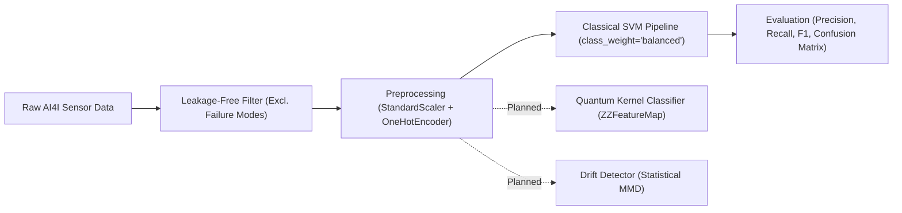

<div align="center">

# Drift-Aware Industrial Fault Detection Using Hybrid Quantum–Classical Machine Learning

**Team:** Phantoms &nbsp;|&nbsp; **Team ID:** VTU-QFF-HC-0005 &nbsp;|&nbsp; **Track:** Quantum + AI/ML

</div>

---

<div align="center">

| | |
| :--- | :--- |
| **Team** | Phantoms |
| **Team ID** | VTU-QFF-HC-0005 |
| **Track** | Quantum + AI/ML |
| **Repository** | [vtu-hc-phantoms](https://github.com/vtu-qiskit-fall-fest-2026/vtu-hc-phantoms.git) |
| **Organisation** | [vtu-qiskit-fall-fest-2026](https://github.com/vtu-qiskit-fall-fest-2026) |
| **Event** | VTU-QFF Hackathon — VTU-Qiskit Fall Fest 2026 |

</div>

---

## 📌 Table of Contents

- [Project Overview & Problem Statement](#-problem-statement)
- [Proposed Solution & Roadmap](#-proposed-solution)
- [Dataset Setup & Leakage Prevention](#-dataset-setup--leakage-prevention)
- [Approach & Architecture](#-approach--architecture)
- [Tech Stack](#-tech-stack)
- [Project Structure](#-project-structure)
- [How to Run Baseline & Tests](#-how-to-run)
- [License](#-license)

---

## ❓ Problem Statement

Industrial fault-detection systems can become unreliable when sensor readings drift over time (due to machine wear, temperature shifts, or recalibration errors) or when labelled fault data is limited. Traditional machine learning models often experience significant performance degradation under distribution shift without alerting human operators.

**Why it matters:** In safety-critical sectors (manufacturing, aerospace, energy), missed faults lead to catastrophic downtime, while uncalibrated alerts overwhelm operators.

**Track:** Quantum + AI/ML

---

## 💡 Proposed Solution

We investigate a hybrid quantum–classical machine learning framework that compares a classical Support Vector Machine (SVM) baseline with a simulated quantum-kernel classifier under controlled sensor drift. The system integrates early sensor drift warnings and uncertainty-aware alerts to flag potentially unreliable predictions for human review.

> [!NOTE]
> **Implementation Status: Phase 2 Completed (Classical Baseline)**
> - [x] **Phase 1: Workspace Scaffolding**: Modular directory structure, repository config, and dependency setup.
> - [x] **Phase 2: Data Loader & Classical Baseline**: Ingestion of UCI AI4I 2020 dataset, leakage-free preprocessing, class-imbalanced RBF-SVM training and evaluation.
> - [ ] **Phase 3: Quantum Kernel Classifier** *(Planned)*: Quantum feature maps (e.g., `ZZFeatureMap`) and `FidelityQuantumKernel` on `AerSimulator`. No quantum advantage is claimed.
> - [ ] **Phase 4: Drift Detection & Uncertainty Alerting** *(Planned)*: Statistical distribution-shift monitoring and human-in-the-loop review alerts.

---

## 📊 Dataset Setup & Leakage Prevention

The project uses the **UCI AI4I 2020 Predictive Maintenance Dataset** (UCI ID `601`), containing 10,000 operational records of synthetic milling machine telemetry.

### 1. Ingestion
The dataset is retrieved automatically via `ucimlrepo` and cached locally to `data/ai4i2020.csv` on first run:
```bash
python -m src.main
```

### 2. Feature Selection & Leakage Prevention
To ensure realistic predictive maintenance modeling without target leakage:
- **Included Features:**
  - `Type`: Product quality variant (`L`, `M`, `H`) — one-hot encoded
  - `Air temperature [K]`
  - `Process temperature [K]`
  - `Rotational speed [rpm]`
  - `Torque [Nm]`
  - `Tool wear [min]`
- **Excluded Columns (Leakage Prevention):**
  - Failure mode indicators (`TWF`, `HDF`, `PWF`, `OSF`, `RNF`): Component-level breakdown causes that directly reveal machine failure.
- **Target Variable:**
  - `Machine failure`: Binary indicator (`0` = normal, `1` = failure).

### 3. Handling Class Imbalance
The dataset contains only **3.39% failure instances** (339 failure records vs 9,661 normal records). To handle this without introducing synthetic interpolation noise in sensor space:
- We employ stratified train/test splitting (`test_size=0.2`, `stratify=y`).
- The Support Vector Classifier is configured with `class_weight='balanced'`, which penalizes minority class (failure) misclassifications inversely proportional to class frequencies:
  $$\omega_j = \frac{n}{k \cdot n_j}$$
  This significantly improves failure recall without data duplication.

---

## 🧩 Approach & Architecture



---

## 🛠️ Tech Stack

| Layer | Technology |
| :--- | :--- |
| Language | Python 3.10+ |
| Classical ML | `scikit-learn`, `numpy`, `pandas`, `matplotlib` |
| Dataset Source | `ucimlrepo` (UCI AI4I 2020 ID: 601) |
| Quantum SDK *(Planned)* | `qiskit`, `qiskit-machine-learning`, `qiskit-aer` |
| Testing | Python standard `unittest` / `pytest` |

---

## 📁 Project Structure

```text
Quantum/
├── src/
│   ├── __init__.py           # Package initializer
│   ├── data_loader.py        # Dataset fetching, caching, and leakage-safe extraction
│   ├── classical_model.py    # Preprocessor and balanced Classical SVM pipeline
│   ├── quantum_model.py      # Quantum feature maps & kernel estimators (Planned)
│   ├── drift_detector.py     # Statistical drift detection heuristics (Planned)
│   ├── uncertainty.py        # Uncertainty quantification & human-review alerts (Planned)
│   └── main.py               # Main pipeline orchestration and evaluation report
├── data/
│   └── .gitkeep              # Data storage directory placeholder
├── tests/
│   └── test_project.py       # Unit and integration test suite
├── requirements.txt          # Python dependencies
├── README.md                 # Project documentation
└── .gitignore                # Git ignore patterns
```

---

## 🚀 How to Run

### 1. Environment Setup

Ensure your virtual environment is active:
```powershell
.venv\Scripts\Activate.ps1
```

Install dependencies:
```bash
pip install -r requirements.txt
```

### 2. Run the Classical Baseline

Execute the end-to-end pipeline:
```bash
python -m src.main
```
This will:
1. Fetch and cache the AI4I 2020 dataset to `data/ai4i2020.csv`.
2. Clean features and exclude leakage columns.
3. Fit the balanced classical RBF-SVM pipeline.
4. Output the complete classification report and confusion matrix.

### 3. Run the Automated Tests

Execute the unit test suite:
```bash
python -m unittest discover -s tests -p "test_*.py" -v
```

---

## 📄 License

Released under the [MIT License](LICENSE). See `LICENSE` for details.

---

<div align="center">

**Phantoms** · Team ID `VTU-QFF-HC-0005` · Built for the VTU-QFF Hackathon

</div>
